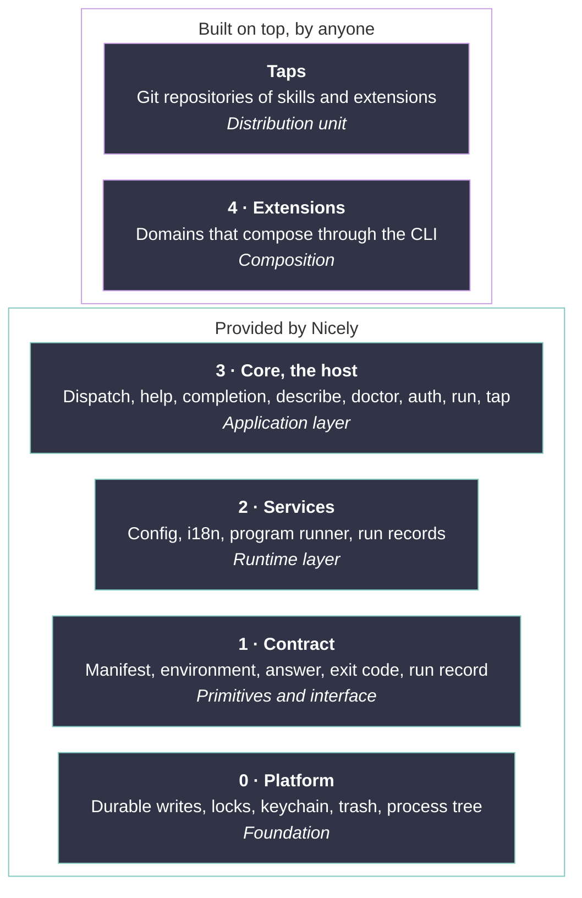

# Nicely architecture

This file says how Nicely is built: its layers, who owns each part, and where each domain lives.

## Core and extensions

Nicely is a small core, and everything it does for a user is an extension, in the spirit of Pi v1: a minimal host that is easy to extend and to compose.

- **Core** is the host: dispatch, help, completion, `describe`, `doctor`, `auth` with grants, `run`, and `tap`. It knows no domain.
- **Extensions** add domains, such as `transcript`. All of them share one manifest format and one contract, and they run with the rights of the user, because Nicely is not a sandbox. A **bundled** extension is compiled into `ncly`. Only what an agent needs to operate Nicely is bundled: `skill`, with the `nicely` skill. An **external** extension is an executable named `ncly-<domain>` beside its manifest. The first-party ones, such as `agent` and `transcript`, live in `extensions/` of this repository, and Pascal's personal tools, such as fleet sync, live in his private tap.

## Layers

The parts form layers. Each box names its layer, what it holds, and, in italics, the design word for its role, as the [glossary](glossary.md#design-vocabulary) defines it.

- A layer depends only on the layers below it, by importing their packages or relying on their formats. Core still starts extensions, through the contract.
- Layers 0 to 2 that extensions need form the public SDK in `sdk/`, which core uses too. The keychain stays in core, and keys reach an extension only through grants.
- An extension reaches core through its environment and the CLI, and another extension only through the CLI, the same interface that agents use.
- Adding a domain never edits core.

Core says where a feature lives, not when it ships. The milestones decide timing.

## Code map

Each part has one owner: one package and one spec section.

| Layer | Part | Owns | Package | Spec |
|---|---|---|---|---|
| 4 | Each extension | Its domain's preparation, business steps, result verification, resume evidence, catalog, and skill | `extensions/<name>/` | Its `spec.md` |
| 3 | Extension host | Discovery, manifests, dispatch, answer checks, and grants | `internal/cli/` | [Extensions](contract.md#extensions) |
| 3 | Core commands | Help, completion, describe, doctor, auth, run, and tap, and core's catalog | `internal/cli/` | [core-spec.md](core-spec.md) |
| 2 | Extension entry | One entry point that serves an extension as `ncly-<domain>` or bundled | `sdk/extension/` | [SDK](contract.md#sdk) |
| 2 | Command line | Declarations turned into commands, global flags, help pages, forms for missing values, and answers printed | `sdk/command/` | [Command descriptions](contract.md#command-descriptions), [Output](contract.md#output) |
| 2 | Program runner | Child environment, process groups, timeouts, signals, process cleanup, and the program check that doctor and status commands share | `sdk/runner/` | [Programs that ncly runs](contract.md#programs-that-ncly-runs), [Required programs](core-spec.md#required-programs) |
| 2 | Record support | Run IDs, durable records, step transitions, execution locks, and result publication | `sdk/` | [Operations](contract.md#operations) |
| 2 | Config | Shared and local config files, environment, flags, and XDG paths | `sdk/config/` | [Configuration](contract.md#configuration) |
| 2 | i18n | Catalogs, lookup, plurals, and number, size, and date formats, and the SDK's own catalog | `sdk/i18n/` | [Configuration](contract.md#configuration) |
| 2 | Interactive parts | The shared styles, forms, and screens | `sdk/tui/` | [dev-preferences.md](dev-preferences.md#decide-the-look-with-a-published-mockup) |
| 1 | Contract | Answer, answer check, error registry, exit codes, modes, declarations, manifests, and streams | `sdk/contract/` | [contract.md](contract.md) |
| 0 | Platform | Durable writes, locks, trash, and process tree | `sdk/platform/` | [Record format](contract.md#record-format), [Programs that ncly runs](contract.md#programs-that-ncly-runs) |
| 0 | Keychain | Keys in the OS keychain, which reach an extension only through grants, and the time limit of each keychain call | `internal/keychain/` | [Keys](contract.md#keys), [Programs that ncly runs](contract.md#programs-that-ncly-runs) |

A later shared service starts in `sdk/`. Core keeps in `internal/` only what an extension never runs: the host, core's commands and catalog, and the keychain. [The milestones](../milestones/) record when each implementation arrives.

The other folders:

- `cmd/ncly/`: the entry point. It passes core an explicit list of bundled extensions and the keychain backend. When started under an extension's name, it runs that extension
- `internal/specdoc/`: reads the tables of the north-star docs for the tests that compare code and spec
- `testdata/script/`: core's testscript scenarios. An extension keeps its own in `extensions/<name>/testdata/script/`, and the test binary of `cmd/ncly` runs both
- `testdata/extensions/hello/`: the Go fixture extension that proves the SDK, laid out as a first-party extension. `./...` skips it, so `just lint` and `just test` name it
- `tools/`: a separate module that pins the dev tools and holds the plan checker behind `just next` and `just test`

## Domains and commands

| Command | What it does | Kind |
|---|---|---|
| `completion` | Prints shell completion scripts | core |
| `describe` | Describes installed commands and their capabilities | core |
| `doctor` | Checks tools, keys, extensions, and components | core |
| `auth` | Stores keys and grants them to extensions | core |
| `run` | Lists, inspects, and explicitly resumes recorded operations | core |
| `tap` | Adds and syncs repositories of skills and extensions | core |
| `skill` | Lists, views, and checks skills for agents, including the `nicely` skill | bundled |
| `agent` | Runs a task through a harness and a profile | external |
| `transcript` | Transcribes YouTube and Zoom audio, then summarizes it | external |
| `markdown`, `video`, `image` | Everyday tasks that need no configuration | external |
| `docs` | Gathers project docs into one private site | external |

[Command tree](core-spec.md#command-tree) lists the names that core reserves. `transcript` is not the first thing a visitor should try, because it needs a Deepgram key. First impressions come from the everyday domains.
