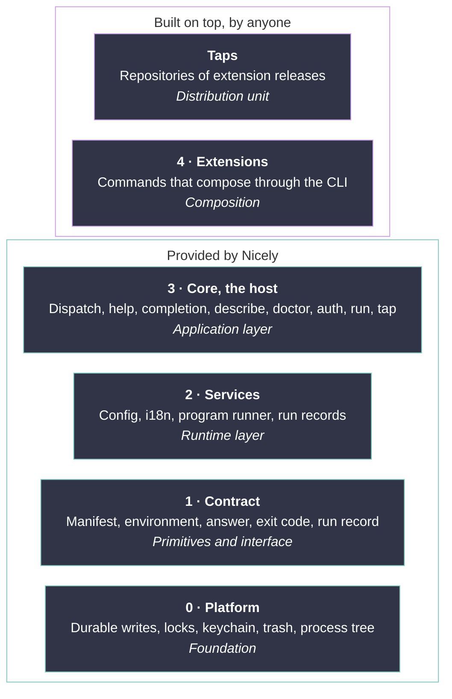

# Nicely architecture

This file says how Nicely is built: its layers, who owns each part, and where each domain lives.

## Core and extensions

Nicely is a small core, and everything it does for a user is an extension, in the spirit of Pi v1: a minimal host that is easy to extend and to compose.

- **Core** is the host: dispatch, help, completion, `describe`, `doctor`, `auth` with grants, `run`, and `tap`. It knows no domain.
- **Extensions** add commands under their roots, as [Extension identity](contract/extension-identity.md) defines. All of them share one manifest format and one contract, and they run with the rights of the user, because Nicely is not a sandbox. A **bundled** extension is compiled into `ncly`. Only what an agent needs to operate Nicely is bundled: `skill`, with the `nicely` skill. An **external** extension is an executable named `ncly-<slug>` beside its manifest. The first-party ones, such as `agent` and `transcript`, live in `extensions/` of this repository. Personal tools can use the same extension format.

[D004](decisions/D004-minimal-core.md) defines how default extensions ship with Nicely.

## Layers

The parts form layers. Each box names its layer, what it holds, and, in italics, the design word for its role, as the [glossary](glossary/design-vocabulary.md) defines it.

- A layer depends only on the layers below it, by importing their packages or relying on their formats. Core still starts extensions, through the contract.
- Layers 0 to 2 that extensions need form the public SDK in `sdk/`, which core uses too. The keychain stays in core, and keys reach an extension only through grants.
- An extension reaches core through its environment and the CLI, and another extension only through the CLI, the same interface that agents use.
- Adding a domain never edits core.

Core says where a feature lives, not when it ships. The backlog queue decides timing.

## Code map

Each part has one owner: one package and one spec section.

| Layer | Part | Owns | Package | Spec |
|---|---|---|---|---|
| 4 | Each extension | Preparation, business steps, result verification, catalog, skill, and recovery evidence beneath its extension root | `extensions/<name>/` | Its `spec.md` |
| 3 | Extension host | Discovery, manifests, dispatch, answer checks, and grants | `internal/cli/` | [Extensions](contract/extensions.md) |
| 3 | Core commands | Help, completion, describe, doctor, auth, run, and tap, and core's catalog | `internal/cli/` | [core-spec.md](core-spec.md) |
| 2 | Extension entry | One entry point that serves an extension as `ncly-<slug>` or bundled, the export of its sidecars, and its embedded workers | `sdk/extension/` | [SDK](contract/sdk.md) |
| 2 | Wrap helper | One program that a handler runs, such as a worker: its check, input, environment, captured output, and failures | `sdk/wrap/` | [Wrapped programs](contract/wrap.md) |
| 2 | Test kit | The tests of an extension repository: its checks, its scenarios, and an install into scratch folders | `sdk/extensiontest/` | [Test kit](contract/test-kit.md) |
| 2 | Command line | Declarations turned into commands, global flags, help pages, forms for missing values, and answers printed | `sdk/command/` | [Command descriptions](contract/command-descriptions.md), [Output](contract/output.md) |
| 2 | Program runner | Child environment, process groups and sessions, captured output, timeouts, signals, process cleanup, and the program check that doctor and status commands share | `sdk/runner/` | [Programs that ncly runs](contract/programs-that-ncly-runs.md), [Required programs](core-spec.md#required-programs) |
| 2 | Record support | Run IDs, durable records, step transitions, execution locks, and result publication | `sdk/` | [Operations](contract/operations.md) |
| 2 | Config | Shared and local config files, environment, flags, and XDG paths | `sdk/config/` | [Configuration](contract/configuration.md) |
| 2 | i18n | Catalogs, lookup, plurals, and number, size, and date formats, and the SDK's own catalog | `sdk/i18n/` | [Configuration](contract/configuration.md) |
| 2 | Interactive parts | The shared styles, forms, and screens | `sdk/tui/` | [dev-preferences.md](dev-preferences.md#decide-the-look-with-a-published-mockup) |
| 1 | Contract | Answer, answer check, error registry, exit codes, modes, declarations, manifests, and streams | `sdk/contract/` | [contract.md](contract.md) |
| 0 | Platform | Durable writes, locks, trash, and process tree | `sdk/platform/` | [Record format](contract/record-format.md), [Programs that ncly runs](contract/programs-that-ncly-runs.md) |
| 0 | Keychain | Keys in the OS keychain, which reach an extension only through grants, and the time limit of each keychain call | `internal/keychain/` | [Keys](contract/keys.md), [Programs that ncly runs](contract/programs-that-ncly-runs.md) |

A later shared service starts in `sdk/`. Core keeps in `internal/` only what an extension never runs: the host, core's commands and catalog, and the keychain. [The backlog](../backlog/README.md) records when each implementation arrives.

The other folders:

- `cmd/ncly/`: the entry point. It passes core an explicit list of bundled extensions and the keychain backend. When started under an extension's name, it runs that extension
- `internal/specdoc/`: reads the tables of the north-star docs for the tests that compare code and spec
- `testdata/script/`: core's testscript scenarios. An extension keeps its own in `extensions/<name>/testdata/script/`, and the test binary of `cmd/ncly` runs both
- `testdata/extensions/hello/`: the Go fixture extension that proves the SDK, laid out as a first-party extension. `./...` skips it, so `just lint` and `just test` name it
- `testdata/extensions/keyed/`: the Go fixture whose commands need a key: `keyed fetch` reads it through `Call.Key`, and `keyed relay` passes it to a program through `sdk/wrap`. Only the scenarios install it, so `hello`, which `just verify` installs in every run, declares no key, and doctor passes in a run without one
- `testdata/extensions/video-convert/` and `video-subtitle/`: named fixtures for root execution and sibling completion. `testdata/extensions/shared/export/` exports their embedded sidecars for verification
- `testdata/extensions/standalone/`: the whole-domain fixture repository of the test kit, a separate Go module that tests `sdk/extensiontest` against `go tool ncly`. Its named-extension counterpart is `testdata/extensions/standalone-named/`. `./...` skips both modules, so `just test`, `just lint`, `just fmt-check`, and `just tidy-check` cover both explicitly
- `copier.yml` and `template/`: the extension template, which creates an extension repository. Its Go files end in `.jinja`, so `./...` never builds them. `just template` renders it with `scripts/template-test.sh` and checks the rendered repository
- `tools/`: a separate module that pins the dev tools and holds the plan checker behind `just next` and `just test`

## Domains and commands

| Command | What it does | Kind |
|---|---|---|
| `completion` | Prints shell completion scripts | core |
| `describe` | Describes installed commands and their capabilities | core |
| `doctor` | Checks tools, keys, extensions, and components | core |
| `auth` | Stores keys and grants them to extensions | core |
| `run` | Lists and inspects recorded operations | core |
| `tap` | Would install extensions from a tap, parked in [COR-622](../backlog/COR-622-taps-offer.md#later) | core |
| `skill` | Lists, views, and checks skills for agents, including the `nicely` skill | bundled |
| `agent` | Runs one trusted Codex task with model and effort settings | external |
| `transcript` | Transcribes one selected YouTube video | external |
| `docs` | Shows selected project docs in one local site | external |

[Command tree](core-spec.md#command-tree) lists the names that core reserves. `transcript` is not the first thing a visitor should try, because it needs a Deepgram key.
M17 selected neither everyday candidate.
[M18](../milestones/M18-extension-template.md) shipped the extension template before any particular extension.
[Markdown view](../backlog/XT-103-markdown-view.md) is Parked.
[Additional video and image jobs](../backlog/XT-602-video-image-jobs.md) remain an Idea.
